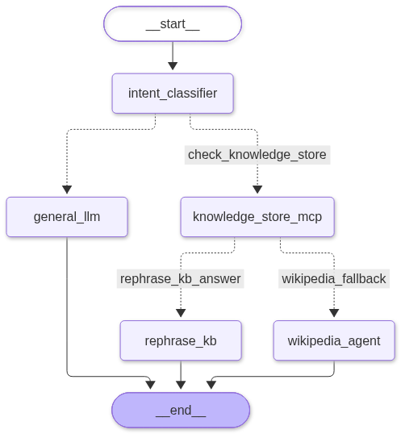

# Enterprise Multi-Agent MCP Hub

An enterprise-grade AI support and catalog resolution platform combining **FastAPI**, **Model Context Protocol (MCP Python SDK v2)**, **Pandas CSV DataFrames**, and **LangGraph Multi-Agent Orchestration**.

---

## 1. Architecture Overview

This system decouples the user-facing REST API from internal domain data and AI agent execution:

* **Frontend Gateway (`app/api/frontend.py`)**: Exposes clean REST endpoints (`/api/v1/chat`, `/api/v1/health`) exclusively for frontend applications.
* **MCP Server Layer (`app/mcp_server/`)**: Explicitly registers `@mcp.resource`, `@mcp.tool`, and `@mcp.prompt` primitives backed by CSV files loaded into Pandas DataFrames.
* **Multi-Agent Orchestrator (`app/agents/`)**: A LangGraph state machine acting as an **MCP Client** that routes queries across three tiers:
  1. **Internal CSV Knowledge Store (via MCP Tools & Resources)** $\rightarrow$ Rephrases retrieved records using an MCP Prompt.
  2. **Wikipedia Fallback Agent** $\rightarrow$ Fetches external gadget specifications when an item is missing from the internal catalog.
  3. **General LLM Agent** $\rightarrow$ Handles general chat or programming questions directly.

---


## 2. Execution workflow 



---
## 3. Project Directory Structure

```text
enterprise_mcp_hub/
├── data/
│   ├── orders.csv              # Order & gadget catalog knowledge store
│   └── subscriptions.csv       # User subscription & billing knowledge store
├── app/
│   ├── __init__.py
│   ├── main.py                 # Application entrypoint, lifespan manager, & routers
│   ├── core/
│   │   ├── config.py           # Pydantic Settings & dynamic root path resolution
│   │   └── datastore.py        # Pandas DataFrame read/write engine
│   ├── mcp_server/
│   │   ├── instance.py         # MCPServer v2 singleton instance
│   │   ├── resources.py        # @mcp.resource read-only DataFrame endpoints
│   │   ├── tools.py            # @mcp.tool search and CSV mutation functions
│   │   └── prompts.py          # @mcp.prompt standardized LLM instruction templates
│   ├── agents/
│   │   ├── state.py            # TypedDict state shared across LangGraph nodes
│   │   ├── nodes.py            # Agent node functions & MCP Client logic
│   │   └── graph.py            # Compiled conditional routing state machine
│   └── api/
│       └── frontend.py         # REST API exposed to the frontend UI
├── visualize_graph.ipynb       # Jupyter Notebook to render the LangGraph Mermaid diagram
├── .env                        # Environment variables (API keys)
└── requirements.txt            # Python dependencies
```

---

## 4. Setup & Execution Commands

### 1. Environment Setup
```bash
python -m venv .venv

# Windows PowerShell
.venv\Scripts\Activate.ps1

# Linux / macOS
source .venv/bin/activate

pip install -r .\requirements.txt
```

### 2. Configure `.env`
Create a `.env` file in the root directory:
```env
OPENAI_API_KEY=your-api-key-here
APP_NAME="Demonstration of Multi-Agent MCP server"
```

### 3. Run the Application
Run from the project root directory using module syntax (`-m`) so Python resolves `app.*` imports properly:
```bash
python -m app.main
```
*(Alternatively: `uvicorn app.main:app --host 0.0.0.0 --port 8000 --reload`)*

---

## 5. Testing All Three Routing Flows

* **Swagger UI**: Visit `http://localhost:8000/docs`
* **Test 1 — Internal CSV Store (MCP Tool + Resource + Prompt)**:
  ```bash
  curl -X POST "http://localhost:8000/api/v1/chat" \
       -H "Content-Type: application/json" \
       -d '{"query": "What is the status of my Wireless Headphones order?"}'
  ```
* **Test 2 — External Gadget Lookup (Wikipedia + MCP Prompt)**:
  ```bash
  curl -X POST "http://localhost:8000/api/v1/chat" \
       -H "Content-Type: application/json" \
